# Lab 3 — Hệ thống phát hiện té ngã với ESP32 & MPU6050

**Sinh viên:** Trần Hải Nam · **Mã sinh viên:** 231432305 · **Đề:** 5

Hệ thống sử dụng ESP32, MPU6050 và FreeRTOS để phát hiện té ngã, truyền dữ liệu qua MQTT và giám sát, điều khiển trên giao diện Web.

## Báo cáo Lab 3

## Đề 5: Thiết kế Mạch phát hiện té ngã (Fall Detection) bằng phép đo gia tốc đột ngột của cơ thể người cũng như thay đổi đột ngột về góc nghiêng. Mạch phát hiện té ngã sử dụng ESP32 đọc dữ liệu gia tốc và góc nghiêng từ cảm biến MPU6050, hiển thị dữ liệu qua giao tiếp serial. Đồng thời ESP32 gửi dữ liệu lên MQTT Broker qua Wifi và hiển thị dữ liệu trên Web/App.

Sinh viên thực hiện: Trần Hải Nam

Mã sinh viên: 231432305

## 1. Giới thiệu về RTOS và FreeRTOS

### 1.1. Giới thiệu về RTOS

RTOS (Real-Time Operating System) là hệ điều hành thời gian thực, được thiết kế để quản lý và điều phối các tác vụ (Task) nhằm đáp ứng yêu cầu nghiêm ngặt về thời gian xử lý của hệ thống. Khác với chương trình thông thường thực hiện các chức năng tuần tự trong một vòng lặp duy nhất, RTOS cho phép nhiều Task hoạt động đồng thời theo cơ chế lập lịch ưu tiên, giúp hệ thống xử lý nhiều công việc một cách hiệu quả và ổn định.

Ưu điểm của RTOS:

- Cho phép thực hiện nhiều tác vụ đồng thời (đa nhiệm).

- Quản lý tài nguyên phần cứng và phân chia thời gian xử lý hợp lý cho từng Task.

- Đáp ứng các yêu cầu về tính thời gian thực (real-time), giảm độ trễ khi xử lý sự kiện khẩn cấp.

- Hỗ trợ các cơ chế giao tiếp và đồng bộ dữ liệu an toàn giữa các Task.

- Giúp chương trình có cấu trúc mô-đun rõ ràng, dễ bảo trì, quản lý và mở rộng.

### 1.2. Giới thiệu về FreeRTOS

FreeRTOS là hệ điều hành thời gian thực mã nguồn mở, có dung lượng nhân rất nhỏ và thường được tích hợp sẵn trong các hệ thống nhúng, vi điều khiển (như ESP32) và thiết bị IoT. FreeRTOS hỗ trợ tạo, quản lý và lập lịch đa nhiệm trên cả hai nhân CPU của ESP32, đồng thời cung cấp đầy đủ các cơ chế giao tiếp và đồng bộ như Queue, Semaphore và Mutex.

Ưu điểm:

- Nhẹ, tiêu thụ ít tài nguyên bộ nhớ Flash và RAM.

- Hỗ trợ đa nhiệm thực sự trên vi điều khiển đa nhân (Dual-Core ESP32) và phân chia mức độ ưu tiên giữa các Task.

- Cung cấp sẵn các cơ chế giao tiếp, đồng bộ dữ liệu an toàn giữa các Task.

- Tích hợp thuận tiện với ESP32 thông qua ESP-IDF và môi trường Arduino.

- Phù hợp với các hệ thống IoT cần vừa thu thập dữ liệu cảm biến tốc độ cao vừa truyền mạng không dây.

Nhược điểm:

- Đòi hỏi người lập trình có kiến thức về lập lịch, phân chia kích thước Stack và đồng bộ tài nguyên.

- Có thể phát sinh lỗi tranh chấp dữ liệu (race condition) hoặc khóa chết (deadlock) nếu thiết kế không chặt chẽ.

- Việc sử dụng nhiều Task làm tăng mức tiêu thụ RAM (do mỗi Task có vùng nhớ Stack riêng) và độ phức tạp chương trình.

- Không tự động bảo đảm tính thời gian thực nếu mức ưu tiên và chu kỳ thực thi của các Task không được thiết kế hợp lý.

### 1.3. Các cơ chế giao tiếp giữa các Task

##### a. Semaphore (Cờ hiệu) và Mutex (Khóa tương hỗ)

Semaphore là cơ chế đồng bộ giữa các Task (hoặc giữa ngắt và Task), cho phép báo hiệu trạng thái sự kiện hoặc kiểm soát quyền truy cập tài nguyên dùng chung. Mutex (Mutual Exclusion) là một dạng Semaphore nhị phân đặc biệt có cơ chế kế thừa độ ưu tiên, chuyên dùng để bảo vệ vùng dữ liệu dùng chung giữa nhiều Task.

- Ưu điểm: Hỗ trợ đồng bộ tiến trình, ngăn chặn tình trạng nhiều Task cùng đọc/ghi một biến toàn cục tại cùng một thời điểm gây sai lệch dữ liệu.

- Ứng dụng: Trong hệ thống phát hiện té ngã này, Mutex (stateMutex) được sử dụng để bảo vệ biến cấu trúc trạng thái đầu ra output (OutputState) giữa Task cảnh báo (cập nhật trạng thái té ngã, LED, Buzzer) và Task truyền data (đọc trạng thái để đóng gói JSON gửi lên MQTT).

##### b. Queue (Hàng đợi)

Queue là cơ chế trao đổi dữ liệu giữa các Task theo nguyên tắc FIFO (First In, First Out – vào trước ra trước) hoặc ghi đè phần tử mới nhất (Overwrite) đối với hàng đợi đơn. Task gửi dữ liệu sao chép bản tin vào hàng đợi, Task nhận lấy dữ liệu ra để xử lý độc lập.

- Ưu điểm: Truyền dữ liệu an toàn luồng (thread-safe) giữa các Task chạy trên các nhân CPU khác nhau, giảm sự phụ thuộc trực tiếp giữa các khối chức năng.

- Ứng dụng: Truyền dữ liệu gia tốc và góc nghiêng từ Task đọc cảm biến MPU6050 sang Task cảnh báo và Task truyền MQTT.

Trong hệ thống này, Queue được sử dụng làm cơ chế giao tiếp chính với ba hàng đợi:

- dataQueue: Lưu trữ 1 mẫu dữ liệu cảm biến mới nhất (cập nhật bằng xQueueOverwrite) gồm gia tốc 3 trục (Ax, Ay, Az), tổng gia tốc chuẩn hóa (totalG) và các góc nghiêng (Roll, Pitch, Tilt) để Task truyền data gửi lên MQTT.

- dataAlert: Hàng đợi FIFO kích thước 32 phần tử, lưu trữ chuỗi mẫu dữ liệu liên tục (tần số 50 Hz) phục vụ Task cảnh báo phân tích biến thiên gia tốc và góc nghiêng để phát hiện té ngã.

- commandQueue: Hàng đợi kích thước 8 phần tử, lưu trữ các lệnh điều khiển nhận từ Web/App (chuyển chế độ AUTO/MANUAL, bật/tắt LED, bật/tắt Buzzer, Reset cảnh báo) để chuyển sang Task cảnh báo thực thi.

## 2. Các bước thực hiện bài Lab

### 2.1. Phân tích yêu cầu và xây dựng mô hình hệ thống

Hệ thống được xây dựng nhằm giám sát liên tục chuyển động của cơ thể người và phát hiện kịp thời các sự cố té ngã đột ngột. ESP32 đọc dữ liệu gia tốc 3 trục và tính toán góc nghiêng từ cảm biến MPU6050 ở tần số 50 Hz, xử lý thuật toán nhận diện té ngã và hiển thị thông tin qua Serial Monitor. Đồng thời, dữ liệu được truyền lên MQTT Broker thông qua Wi-Fi để giao diện Web/App giám sát trực quan bằng các thẻ số, biểu đồ thời gian thực và điều khiển thiết bị cảnh báo từ xa.

Hệ thống gồm bốn khối chức năng chính:

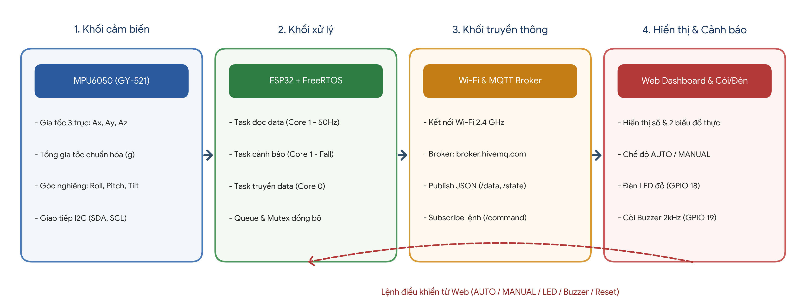

Hình 1.1: Các khối chức năng chính trong hệ thống phát hiện té ngã

- Khối cảm biến: MPU6050 (GY-521) đo gia tốc theo 3 trục X, Y, Z và hỗ trợ tính toán tổng gia tốc chuẩn hóa (g) cùng các góc nghiêng (Roll, Pitch, Tilt).

- Khối xử lý: ESP32 tiếp nhận dữ liệu qua chuẩn I2C, thực thi đồng thời các Task bằng FreeRTOS trên 2 nhân CPU và chạy thuật toán phát hiện té ngã.

- Khối truyền thông: Wi-Fi và MQTT Broker (broker.hivemq.com) truyền dữ liệu cảm biến, trạng thái hệ thống và lệnh điều khiển hai chiều giữa ESP32 và Web/App.

- Khối hiển thị và cảnh báo: Trang Web hiển thị thông số gia tốc/góc nghiêng, vẽ 2 biểu đồ thời gian thực, cung cấp nút điều khiển chế độ AUTO/MANUAL, LED, Buzzer, Reset và kích hoạt còi đèn cảnh báo tại chỗ.

### 2.2. Các linh kiện sử dụng

Bảng 2.1. Danh sách linh kiện và thông số kỹ thuật

| STT | Linh kiện | SL | Thông số kỹ thuật | Chức năng |
| --- | --- | --- | --- | --- |
| 1 | ESP32 DevKit V1 | 1 | CPU Xtensa LX6 32-bit Dual-Core, tần số tối đa 240 MHz, Wi-Fi 2.4 GHz, Bluetooth 4.2, điện áp hoạt động 3.3 V, hỗ trợ GPIO và I2C. | Xử lý dữ liệu, chạy FreeRTOS, phân tích thuật toán té ngã, kết nối Wi-Fi/MQTT và điều khiển thiết bị. |
| 2 | Cảm biến MPU6050 (GY-521) | 1 | Điện áp hoạt động 3.3–5 V, giao tiếp I2C (địa chỉ 0x68), tích hợp gia tốc kế 3 trục (±2g đến ±16g) và con quay hồi chuyển 3 trục (±250 đến ±2000 °/s), ADC 16-bit. | Đo gia tốc 3 trục Ax, Ay, Az và xác định sự thay đổi đột ngột về gia tốc, góc nghiêng của cơ thể. |
| 3 | LED (Màu đỏ) | 1 | Điện áp thuận khoảng 1.8–2.2 V (LED đỏ), dòng hoạt động thường khoảng 5–20 mA. | Phát tín hiệu cảnh báo trực quan bằng ánh sáng khi phát hiện té ngã hoặc bật thủ công. |
| 4 | Điện trở | 1 | Giá trị 220 Ω, công suất 1/4 W. | Hạn chế dòng điện qua LED, bảo vệ LED và chân GPIO 18 của ESP32. |
| 5 | Buzzer | 1 | Điện áp hoạt động 3.3–5 V, điều khiển xung PWM/Tone tần số 2000 Hz. | Phát tín hiệu cảnh báo bằng âm thanh khi phát hiện té ngã hoặc bật thủ công. |
| 6 | Dây nối | Theo nhu cầu | Dây jumper đực-đực / đực-cái dùng kết nối nguồn 3.3 V, GND và tín hiệu I2C/GPIO. | Kết nối các linh kiện trong mạch. |

#### 2.2.1. ESP32

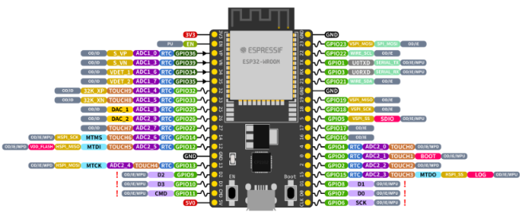

Hình 2.2: Vi điều khiển ESP32 DevKit V1

ESP32 là bộ điều khiển trung tâm của hệ thống, tích hợp bộ vi xử lý hai nhân (Core 0 và Core 1) cùng mô-đun kết nối Wi-Fi, Bluetooth. Vi điều khiển hỗ trợ hệ điều hành thời gian thực FreeRTOS, cho phép tách biệt tác vụ đọc cảm biến/cảnh báo thời gian thực với tác vụ truyền nhận mạng MQTT.

- Điện áp logic: 3.3 V.

- Tần số CPU tối đa: 240 MHz.

- Kết nối Wi-Fi: 2.4 GHz, chuẩn IEEE 802.11 b/g/n.

- Giao tiếp ngoại vi: GPIO, I2C (SDA – GPIO 21, SCL – GPIO 22), SPI, UART, PWM.

#### 2.2.2. Cảm biến MPU6050

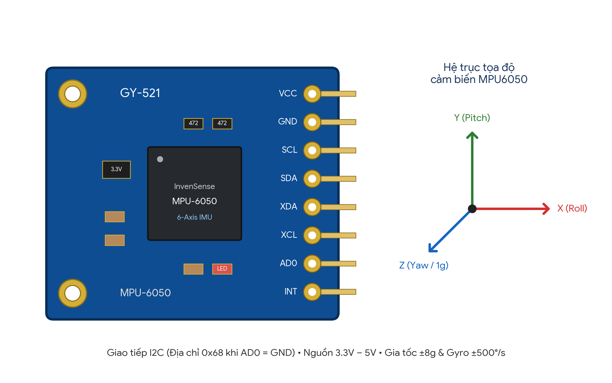

Hình 2.3: Cảm biến gia tốc và con quay hồi chuyển MPU6050 (Module GY-521)

MPU6050 là cảm biến đo lường quán tính 6 trục (6-Axis IMU) tích hợp gia tốc kế 3 trục (Accelerometer) và con quay hồi chuyển 3 trục (Gyroscope) trên cùng một vi mạch, giao tiếp với ESP32 thông qua chuẩn I2C.

- Điện áp hoạt động: 3.3–5 V (tích hợp IC ổn áp 3.3 V trên module GY-521).

- Dải đo gia tốc cấu hình: ±8g (MPU6050_RANGE_8_G) giúp bắt trọn xung va chạm mạnh khi té ngã mà không bị bão hòa.

- Dải đo con quay hồi chuyển cấu hình: ±500 °/s (MPU6050_RANGE_500_DEG), bộ lọc thông thấp DLPF 21 Hz.

- Giao tiếp: Chuẩn I2C với địa chỉ mặc định 0x68 (khi chân AD0 nối mức thấp GND).

Từ các thành phần gia tốc đo được (Ax, Ay, Az tính theo m/s²), ESP32 tính toán độ lớn gia tốc tổng hợp chuẩn hóa theo gia tốc trọng trường (totalG) và các góc nghiêng đặc trưng (Roll, Pitch và góc nghiêng tổng hợp Tilt so với phương thẳng đứng) để đánh giá tư thế người dùng.

#### 2.2.3. LED

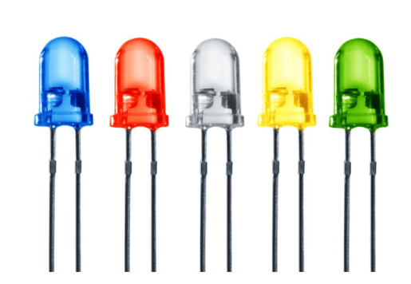

Hình 2.4: Đèn LED cảnh báo

LED màu đỏ được sử dụng để hiển thị trạng thái cảnh báo té ngã hoặc trạng thái điều khiển bằng ánh sáng.

- Điện áp thuận: khoảng 1.8–2.2 V đối với LED đỏ.

- Dòng điện hoạt động: thường 5–20 mA.

- Kết nối với chân GPIO 18 của ESP32 thông qua điện trở hạn dòng 220 Ω.

#### 2.2.4. Điện trở

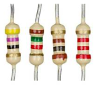

Hình 2.5: Điện trở hạn dòng 220 Ω

Điện trở được mắc nối tiếp với cực dương (Anode) của LED nhằm hạn chế dòng điện, tránh làm hỏng LED và bảo vệ chân GPIO 18 của ESP32.

- Giá trị điện trở: 220 Ω.

- Công suất: 1/4 W.

- Loại: điện trở cố định.

#### 2.2.5. Buzzer

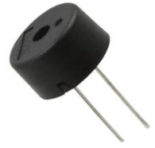

Hình 2.6: Còi cảnh báo Buzzer

Buzzer là linh kiện chuyển đổi tín hiệu điện thành âm thanh, được sử dụng để phát còi báo động khi phát hiện người dùng bị té ngã.

- Điện áp hoạt động: 3.3–5 V.

- Điều khiển: xuất tín hiệu âm tần 2000 Hz bằng hàm tone(BUZZER_PIN, 2000) trên chân GPIO 19 của ESP32.

### 2.3. Thiết kế mạch kết nối trên Wokwi

Sử dụng ESP32 DevKit V1 làm bộ điều khiển trung tâm, kết nối với cảm biến MPU6050 thông qua giao tiếp I2C (SDA nối GPIO 21, SCL nối GPIO 22, chân AD0 nối GND để cố định địa chỉ 0x68). Các thiết bị cảnh báo gồm đèn LED đỏ (qua điện trở 220 Ω) và còi Buzzer được kết nối lần lượt với chân GPIO 18 và GPIO 19 của ESP32.

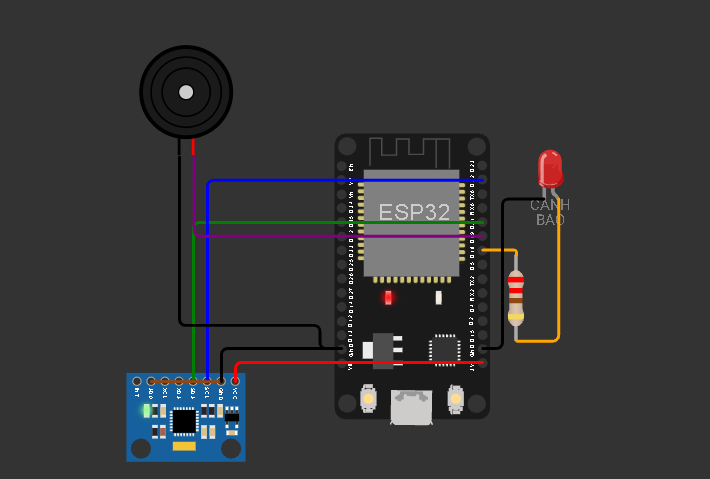

Hình 2.7: Sơ đồ mạch kết nối trên Wokwi

Bảng sơ đồ chân kết nối giữa các linh kiện và ESP32:

Bảng 2.2. Sơ đồ chân các thiết bị với ESP32

| Thiết bị | Chân thiết bị | Chân ESP32 | Ghi chú kết nối |
| --- | --- | --- | --- |
| MPU6050 | VCC | 3V3 | Cấp nguồn 3.3 V cho cảm biến |
| MPU6050 | GND | GND | Nối mass chung toàn mạch |
| MPU6050 | SDA | GPIO 21 | Đường truyền dữ liệu I2C |
| MPU6050 | SCL | GPIO 22 | Đường xung nhịp đồng bộ I2C |
| MPU6050 | AD0 | GND | Thiết lập địa chỉ I2C là 0x68 |
| LED đỏ | Anode (+) | GPIO 18 | Mắc nối tiếp qua điện trở hạn dòng 220 Ω |
| LED đỏ | Cathode (−) | GND | Nối mass chung |
| Buzzer | Chân dương (+) | GPIO 19 | Nhận xung âm tần 2000 Hz điều khiển còi |
| Buzzer | Chân âm (−) | GND | Nối mass chung |

### 2.4. Triển khai FreeRTOS trên ESP32

Hệ thống được chia thành ba Task độc lập phân bổ trên hai nhân của ESP32. Việc phân chia này giúp quá trình lấy mẫu cảm biến tốc độ cao (50 Hz) và phân tích té ngã không bị gián đoạn bởi độ trễ kết nối mạng Wi-Fi hay MQTT.

Bảng 2.3. Phân chia các Task trong hệ thống

| Task | Core | Độ ưu tiên | Stack (Byte) | Chức năng chính |
| --- | --- | --- | --- | --- |
| Task truyền data
(TaskTransmit) | 0 | 1 | 8192 | Kết nối Wi-Fi, kết nối MQTT Broker, nhận mẫu từ dataQueue và trạng thái từ output, đóng gói JSON gửi lên Broker; đồng thời nhận lệnh điều khiển từ Web. |
| Task đọc data
(TaskRead) | 1 | 2 | 4096 | Đọc gia tốc 3 trục từ MPU6050 ở tần số 50 Hz (chu kỳ 20 ms), tính toán totalG và các góc Roll, Pitch, Tilt, in Serial và đẩy dữ liệu vào dataQueue, dataAlert. |
| Task cảnh báo
(TaskAlert) | 1 | 3 | 4096 | Nhận chuỗi dữ liệu từ dataAlert, chạy thuật toán phát hiện té ngã FallDetector, nhận lệnh từ commandQueue và điều khiển LED (GPIO 18), Buzzer (GPIO 19). |

##### a. Task đọc data (TaskRead – Core 1)

Task đọc data sử dụng hàm vTaskDelayUntil() với chu kỳ chính xác 20 ms (tần số 50 Hz) để thực hiện các công việc:

- Khởi tạo giao tiếp I2C (GPIO 21, GPIO 22) và kiểm tra kết nối với cảm biến MPU6050 tại địa chỉ 0x68 (tự động thử kết nối lại sau mỗi 2 giây nếu mất tín hiệu).

- Đọc giá trị gia tốc 3 trục Ax, Ay, Az (đơn vị m/s²) từ cảm biến.

- Tính toán độ lớn gia tốc chuẩn hóa theo trọng trường totalG (đơn vị g), góc nghiêng ngang Roll, góc nghiêng dọc Pitch và góc nghiêng tổng hợp Tilt so với phương thẳng đứng (đơn vị độ).

- Hiển thị định kỳ các thông số đo được lên Serial Monitor mỗi 200 ms.

- Ghi đè mẫu dữ liệu mới nhất vào hàng đợi dataQueue (xQueueOverwrite) và đẩy vào hàng đợi dataAlert (xQueueSend) phục vụ phân tích té ngã.

##### b. Task truyền data (TaskTransmit – Core 0)

Task truyền data chạy độc lập trên Core 0 để không làm ảnh hưởng đến nhịp đọc cảm biến trên Core 1, thực hiện các công việc:

- Khởi tạo và duy trì kết nối mạng Wi-Fi (SSID: Wokwi-GUEST), tự động kết nối lại nếu mất mạng.

- Kết nối tới MQTT Broker công cộng (broker.hivemq.com, cổng 1883) với cơ chế Last Will and Testament (LWT) báo trạng thái online/offline.

- Đăng ký (Subscribe) chủ đề nhận lệnh điều khiển từ giao diện Web.

- Định kỳ mỗi 200 ms, lấy mẫu cảm biến mới nhất từ dataQueue và đọc trạng thái hệ thống (được bảo vệ bởi stateMutex), đóng gói thành chuỗi JSON bằng thư viện ArduinoJson và gửi (Publish) lên MQTT Broker.

##### c. Task cảnh báo (TaskAlert – Core 1, ưu tiên cao nhất)

Task cảnh báo nhận dữ liệu từ hàng đợi dataAlert và commandQueue để xử lý logic tự động và thủ công:

- Giai đoạn 1 – Phát hiện va chạm / rơi tự do (Shock): Kiểm tra nếu tổng gia tốc tăng đột ngột (totalG ≥ 1.8g), giảm đột ngột khi rơi tự do (totalG ≤ 0.45g), hoặc biến thiên giữa hai lần đo liên tiếp lớn (|ΔtotalG| ≥ 0.65g) thì đánh dấu trạng thái nghi ngờ té ngã (candidate = true).

- Giai đoạn 2 – Kiểm tra thay đổi tư thế sau va chạm: Trong cửa sổ thời gian 5 giây kể từ lúc có sốc gia tốc, nếu cơ thể ổn định trở lại (0.7g ≤ totalG ≤ 1.3g) nhưng góc nghiêng so với phương thẳng đứng Tilt ≥ 55° và góc lệch so với vector tư thế ban đầu ≥ 35°, hệ thống bắt đầu đếm thời gian duy trì tư thế nằm.

- Giai đoạn 3 – Xác nhận té ngã (Latch): Khi tư thế nằm nghiêng duy trì liên tục tối thiểu 400 ms, hệ thống chốt trạng thái cảnh báo té ngã (latched = true), tự động bật sáng LED đỏ (GPIO 18) và phát còi Buzzer tần số 2000 Hz (GPIO 19).

- Xử lý lệnh từ Web/App: Nhận lệnh từ commandQueue để chuyển đổi giữa hai chế độ AUTO và MANUAL, bật/tắt LED và Buzzer thủ công khi ở chế độ MANUAL, hoặc thực hiện lệnh Reset để xóa chốt cảnh báo té ngã.

### 2.5. Thiết kế giao diện Web/App

Giao diện Web được xây dựng bằng HTML, CSS và JavaScript, sử dụng thư viện MQTT.js kết nối trực tiếp với MQTT Broker (broker.hivemq.com) thông qua giao thức WebSocket để cập nhật dữ liệu cảm biến theo thời gian thực và gửi lệnh điều khiển xuống ESP32.

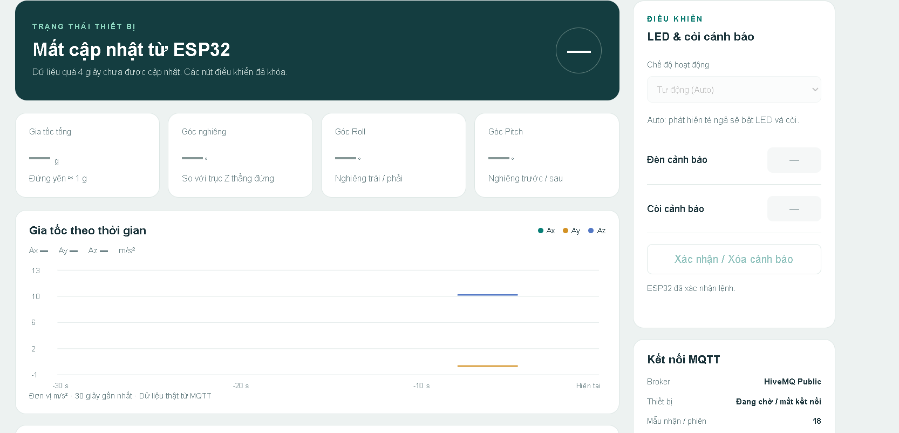

Hình 2.8: Giao diện Web giám sát và điều khiển hệ thống phát hiện té ngã

Giao diện gồm các thành phần chính:

##### a. Khu vực hiển thị thông số và trạng thái

- Các thẻ hiển thị giá trị gia tốc 3 trục Ax, Ay, Az (m/s²) và độ lớn tổng gia tốc chuẩn hóa TotalG (g).

- Các thẻ hiển thị giá trị góc nghiêng Roll, Pitch và góc nghiêng tổng hợp Tilt (°).

- Khung hiển thị trạng thái kết nối thiết bị (Online/Offline), chế độ hoạt động hiện tại (AUTO / MANUAL) và cảnh báo té ngã (Bình thường / Nghi ngờ / Phát hiện té ngã).

##### b. Khu vực biểu đồ thời gian thực

- Biểu đồ gia tốc: vẽ đường biến thiên của tổng gia tốc TotalG (g) theo thời gian thực giúp quan sát rõ các xung va chạm.

- Biểu đồ góc nghiêng: vẽ đường biến thiên của góc nghiêng Tilt / Roll / Pitch (°) theo thời gian thực giúp nhận biết sự thay đổi tư thế đột ngột.

##### c. Khu vực điều khiển thiết bị

- Nút chuyển chế độ AUTO / MANUAL: cho phép chuyển qua lại giữa chế độ cảnh báo té ngã tự động và chế độ kiểm thử điều khiển tay.

- Nút điều khiển LED ON/OFF: bật hoặc tắt đèn LED cảnh báo trên ESP32 khi hệ thống ở chế độ MANUAL.

- Nút điều khiển Buzzer ON/OFF: bật hoặc tắt còi Buzzer trên ESP32 khi hệ thống ở chế độ MANUAL.

- Nút Reset cảnh báo: đặt lại trạng thái chốt té ngã (latched) sau khi đã xử lý sự cố.

Bảng 2.4. Hệ thống Topic MQTT sử dụng (TOPIC_BASE = utc/lovis/de5/fall/a73c91)

| Topic | Hướng truyền | Chức năng |
| --- | --- | --- |
| utc/lovis/de5/fall/a73c91/data | ESP32 → Web | Gửi gói tin JSON chứa dữ liệu cảm biến (ax, ay, az, total_g, roll, pitch, tilt, seq, ms) mỗi 200 ms. |
| utc/lovis/de5/fall/a73c91/state | ESP32 → Web | Gửi trạng thái hoạt động hiện tại của hệ thống (mode: AUTO/MANUAL, led, buzzer, fall, candidate, sensor_ok, ack). |
| utc/lovis/de5/fall/a73c91/command | Web → ESP32 | Gửi lệnh điều khiển dạng JSON (mode, led, buzzer, reset kèm mã phiên boot và mã lệnh id) xuống ESP32. |
| utc/lovis/de5/fall/a73c91/status | ESP32 → Web | Gửi trạng thái kết nối thiết bị (online / offline thông qua cơ chế MQTT Last Will). |

### 2.6. Xây dựng chương trình và giải thích code

Chương trình cho ESP32 được lập trình bằng ngôn ngữ C/C++ trên nền tảng Arduino Core for ESP32 và mô phỏng trên môi trường Wokwi. Các thư viện sử dụng trong dự án được liệt kê ở Bảng 2.5.

Bảng 2.5. Các thư viện sử dụng

| Thư viện | Chức năng |
| --- | --- |
| Arduino.h | Hỗ trợ các hàm vào/ra cơ bản, định thời millis() và phát xung tone() trên ESP32. |
| Wire.h | Cung cấp giao thức truyền thông I2C kết nối ESP32 với cảm biến MPU6050. |
| Adafruit_MPU6050.h &amp; Adafruit_Sensor.h | Khởi tạo, cấu hình dải đo và đọc dữ liệu gia tốc kế, con quay hồi chuyển từ MPU6050. |
| WiFi.h | Quản lý kết nối mạng không dây Wi-Fi trên ESP32. |
| PubSubClient.h | Triển khai giao thức MQTT Client để kết nối Broker, Publish dữ liệu và Subscribe lệnh. |
| ArduinoJson.h | Đóng gói (Serialize) dữ liệu cảm biến/trạng thái và giải mã (Deserialize) lệnh điều khiển JSON. |
| freertos/FreeRTOS.h, task.h, queue.h, semphr.h | Cung cấp nhân hệ điều hành thời gian thực FreeRTOS, tạo Task đa nhân, Queue và Mutex. |

Cấu trúc tổng thể của chương trình được chia thành các phần chính:

- Khai báo thư viện, chân kết nối (LED_PIN = 18, BUZZER_PIN = 19), cấu trúc dữ liệu Sample, Command, OutputState và lớp thuật toán FallDetector.

- Xây dựng hàm mqttCallback() để tiếp nhận và kiểm tra tính hợp lệ của các bản tin lệnh JSON gửi từ Web.

- Xây dựng TaskRead() đọc cảm biến MPU6050 ở tần số 50 Hz, tính toán gia tốc tổng hợp và các góc nghiêng.

- Xây dựng TaskAlert() chạy thuật toán phát hiện té ngã, xử lý lệnh điều khiển từ commandQueue và điều khiển LED, Buzzer.

- Xây dựng TaskTransmit() kết nối Wi-Fi, duy trì phiên MQTT và gửi dữ liệu JSON từ dataQueue, output lên Broker.

- Hàm setup() khởi tạo Serial, sinh mã phiên ngẫu nhiên bootId, khởi tạo các Queue, Mutex và phân chia các Task lên Core 0 và Core 1 bằng xTaskCreatePinnedToCore().

Đoạn code 1: Khởi tạo kết nối Wi-Fi, MQTT Broker và hàm nhận lệnh điều khiển (TaskTransmit & mqttCallback)

| void mqttCallback(char *topic, byte *payload, unsigned int length) {
  if (strcmp(topic, topicCommand) != 0 &#124;&#124; length &gt; 256) return;
  JsonDocument doc;
  if (deserializeJson(doc, payload, length)) return;
  // Lenh chi co gia tri voi phien khoi dong hien tai
  if (strcmp(doc[&quot;boot&quot;] &#124; &quot;&quot;, bootId) != 0) return;
  const char *name = doc[&quot;command&quot;] &#124; &quot;&quot;;
  const char *id = doc[&quot;id&quot;] &#124; &quot;&quot;;
  if (!*id &#124;&#124; strlen(id) &gt;= 64) return;
  if (strcmp(name,&quot;mode&quot;) &amp;&amp; strcmp(name,&quot;led&quot;) &amp;&amp;
      strcmp(name,&quot;buzzer&quot;) &amp;&amp; strcmp(name,&quot;reset&quot;)) return;
  if (strcmp(name,&quot;reset&quot;) &amp;&amp; !doc[&quot;value&quot;].is&lt;bool&gt;()) return;

  Command cmd = {};
  strlcpy(cmd.name, name, sizeof(cmd.name));
  strlcpy(cmd.id, id, sizeof(cmd.id));
  cmd.value = doc[&quot;value&quot;] &#124; false;
  xQueueSend(commandQueue, &amp;cmd, 0); // Day lenh vao hang doi cho TaskAlert xu ly
} |
| --- |

Giải thích: Hàm mqttCallback() được gọi tự động mỗi khi ESP32 nhận được gói tin trên topic command. Hàm giải mã chuỗi JSON, kiểm tra mã định danh phiên khởi động (bootId) để loại bỏ các lệnh tồn đọng cũ, xác thực tên lệnh (mode, led, buzzer, reset) rồi đưa vào hàng đợi commandQueue mà không làm treo tác vụ mạng.

Đoạn code 2: Đọc cảm biến MPU6050, tính toán gia tốc & góc nghiêng và đẩy vào Queue (TaskRead)

| sensors_event_t a = {}, g = {}, t = {};
s.valid = mpu.getEvent(&amp;a, &amp;g, &amp;t);
s.ax = a.acceleration.x; s.ay = a.acceleration.y; s.az = a.acceleration.z;
float magnitude = sqrtf(s.ax*s.ax + s.ay*s.ay + s.az*s.az);
s.totalG = magnitude / 9.80665f;
s.roll   = atan2f(s.ay, s.az) * 57.2957795f;
s.pitch  = atan2f(-s.ax, sqrtf(s.ay*s.ay + s.az*s.az)) * 57.2957795f;
s.tilt   = magnitude &gt; 0.1f ? acosf(fmaxf(-1, fminf(1, s.az/magnitude))) * 57.2957795f : 0;

xQueueOverwrite(dataQueue, &amp;s); // Luon cap nhat mau moi nhat cho TaskTransmit
if (xQueueSend(dataAlert, &amp;s, 0) != pdPASS) {
  Sample old;
  xQueueReceive(dataAlert, &amp;old, 0); // Bo mau cu nhat neu FIFO day
  xQueueSend(dataAlert, &amp;s, 0);
}
vTaskDelayUntil(&amp;wake, pdMS_TO_TICKS(20)); // Chu ky lay mau 20ms (50 Hz) |
| --- |

Giải thích: Trong TaskRead() trên Core 1, ESP32 đọc gia tốc 3 trục từ MPU6050 mỗi 20 ms (50 Hz), tính độ lớn gia tốc chuẩn hóa totalG (g) và các góc nghiêng Roll, Pitch, Tilt (độ) bằng các hàm lượng giác ngược. Dữ liệu sau đó được ghi đè vào dataQueue để gửi lên Web và đưa vào hàng đợi FIFO dataAlert cho thuật toán phát hiện té ngã.

Đoạn code 3: Thuật toán phát hiện té ngã 3 giai đoạn và điều khiển còi/đèn (FallDetector & TaskAlert)

| bool shock = s.totalG &gt;= 1.8f &#124;&#124; s.totalG &lt;= 0.45f &#124;&#124;
             fabsf(s.totalG - previousG) &gt;= 0.65f;
if (!candidate &amp;&amp; shock) { candidate = true; started = s.ms; holding = false; }
if (candidate) {
  if ((uint32_t)(s.ms - started) &gt; 5000) candidate = holding = false;
  else {
    // Tinh goc lech so voi vector tu the ban dau (bx, by, bz)
    float denom = sqrtf(bx*bx + by*by + bz*bz) * s.totalG * 9.80665f;
    float cosine = denom &gt; 0.01f ? (bx*s.ax + by*s.ay + bz*s.az)/denom : 1;
    float change = acosf(fmaxf(-1, fminf(1, cosine))) * 57.2957795f;
    bool posture = s.totalG &gt;= 0.7f &amp;&amp; s.totalG &lt;= 1.3f &amp;&amp; s.tilt &gt;= 55 &amp;&amp; change &gt;= 35;
    if (!posture) holding = false;
    else if (!holding) { holding = true; heldSince = s.ms; }
    else if ((uint32_t)(s.ms - heldSince) &gt;= 400) { latched = true; candidate = false; }
  }
} |
| --- |

Giải thích: Lớp FallDetector phân tích từng mẫu trong dataAlert. Khi phát hiện xung va chạm mạnh (≥ 1.8g), rơi tự do (≤ 0.45g) hoặc biến thiên gia tốc đột ngột (≥ 0.65g), hệ thống chuyển sang trạng thái nghi ngờ (candidate). Nếu trong vòng 5 giây tiếp theo người dùng nằm nghiêng với góc Tilt ≥ 55°, lệch ≥ 35° so với tư thế ban đầu và duy trì liên tục từ 400 ms trở lên, biến latched được kích hoạt để bật đèn LED đỏ (GPIO 18) và phát còi Buzzer 2000 Hz (GPIO 19).

### 2.7. Kiểm thử và đánh giá kết quả

Sau khi hoàn thiện chương trình và giao diện Web, tiến hành kiểm thử lần lượt các kịch bản hoạt động của hệ thống:

Bảng 2.6. Các trường hợp kiểm thử

| STT | Nội dung kiểm thử | Kết quả mong đợi |
| --- | --- | --- |
| 1 | Khởi động ESP32, đọc dữ liệu từ cảm biến MPU6050, kết nối Wi-Fi và MQTT Broker | Các Task được khởi tạo thành công trên Core 0 và Core 1; ESP32 đọc chính xác gia tốc Ax, Ay, Az, góc nghiêng Roll, Pitch, Tilt và kết nối thành công với Broker. |
| 2 | Kiểm tra quá trình truyền dữ liệu qua MQTT lên giao diện Web | Dữ liệu cảm biến được đóng gói JSON gửi lên topic .../data; giao diện Web hiển thị trạng thái Online, cập nhật thẻ số và 2 biểu đồ thời gian thực. |
| 3 | Mô phỏng sự cố té ngã (gia tốc đột ngột và thay đổi góc nghiêng vượt ngưỡng) | Hệ thống ở chế độ AUTO phát hiện sốc gia tốc và góc nghiêng Tilt ≥ 55°, chốt cảnh báo té ngã, tự động bật sáng LED đỏ và phát âm thanh Buzzer. |
| 4 | Kiểm thử chức năng Reset trạng thái cảnh báo sau khi phát hiện té ngã | Nhấn nút Reset trên giao diện Web, ESP32 nhận lệnh qua topic .../command, xóa chốt cảnh báo té ngã, tắt LED và Buzzer, đưa hệ thống về giám sát bình thường. |
| 5 | Nhấn nút điều khiển LED trên giao diện Web ở chế độ MANUAL | Chuyển sang chế độ MANUAL và nhấn nút bật LED trên Web; lệnh được gửi qua MQTT, đèn LED trên mạch Wokwi bật sáng và trạng thái trên Web cập nhật tương ứng. |
| 6 | Nhấn nút điều khiển Buzzer trên giao diện Web ở chế độ MANUAL | Ở chế độ MANUAL, nhấn nút bật Buzzer trên Web; lệnh được gửi qua MQTT, còi Buzzer trên mạch Wokwi phát tiếng kêu 2000 Hz và trạng thái trên Web cập nhật tương ứng. |

## 3. Kết quả thực hiện

Khởi động ESP32, đọc dữ liệu từ cảm biến MPU6050, kết nối Wi-Fi và MQTT Broker

Sau khi khởi động mô phỏng trên Wokwi, ESP32 tiến hành khởi tạo các hàng đợi Queue, khóa Mutex và phân bổ ba Task lên hai nhân xử lý. Cảm biến MPU6050 được khởi tạo thành công trên Core 1, đọc liên tục các thành phần gia tốc Ax, Ay, Az và góc nghiêng Roll, Pitch, Tilt. Đồng thời, Task truyền dữ liệu trên Core 0 kết nối thành công mạng Wi-Fi và MQTT Broker (broker.hivemq.com).

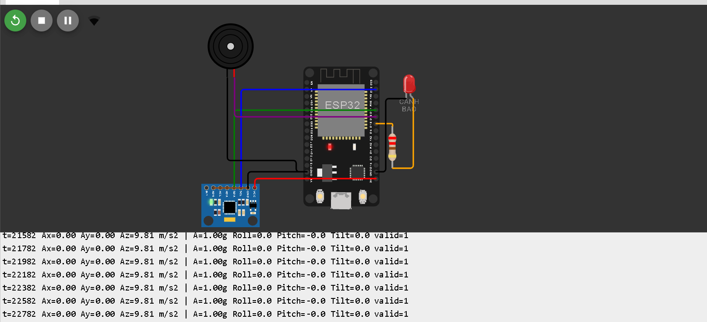

Hình 3.1. Kết quả khởi động ESP32, đọc dữ liệu cảm biến MPU6050 và kết nối Wi-Fi, MQTT Broker

Kiểm tra quá trình truyền dữ liệu qua MQTT

Dữ liệu sau khi được đọc từ cảm biến MPU6050 sẽ được đưa vào hàng đợi dataQueue và chuyển đến Task truyền dữ liệu. Task này đóng gói JSON và gửi thông tin lên MQTT Broker thông qua topic utc/lovis/de5/fall/a73c91/data. Giao diện Web đăng ký nhận dữ liệu từ topic tương ứng, hiển thị trạng thái kết nối trực tuyến và cập nhật liên tục các giá trị gia tốc, góc nghiêng trên các thẻ số cũng như hai biểu đồ thời gian thực.

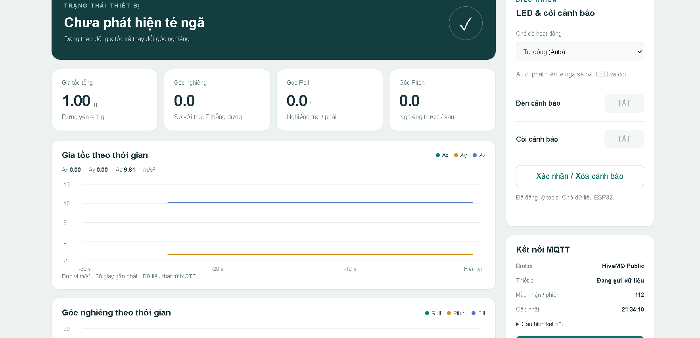

Hình 3.2. Kết quả truyền dữ liệu cảm biến qua MQTT Broker và hiển thị trên giao diện Web

Phát hiện té ngã tự động khi gia tốc và góc nghiêng thay đổi đột ngột

Khi người dùng điều chỉnh thanh trượt gia tốc trên cảm biến MPU6050 của Wokwi để tạo ra cú sốc gia tốc đột ngột (totalG ≥ 1.8g hoặc totalG ≤ 0.45g) kèm theo sự thay đổi góc nghiêng vượt ngưỡng (Tilt ≥ 55° duy trì trên 400 ms), thuật toán FallDetector trong Task cảnh báo xác nhận sự cố té ngã. Hệ thống lập tức bật sáng đèn LED đỏ, phát âm thanh cảnh báo từ còi Buzzer và cập nhật trạng thái cảnh báo té ngã lên giao diện Web.

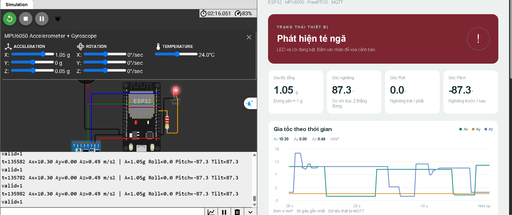

Hình 3.3. Kết quả kiểm thử chức năng phát hiện té ngã và cảnh báo tự động bằng còi đèn

Đặt lại trạng thái cảnh báo (Reset) sau khi phát hiện té ngã

Sau khi hệ thống đã chốt cảnh báo té ngã (latched), trạng thái cảnh báo vẫn được duy trì để đảm bảo người giám sát không bỏ lỡ sự cố ngay cả khi người bị ngã chưa thể đứng dậy. Khi nhấn nút Reset trên giao diện Web và đưa cảm biến về tư thế thẳng đứng bình thường, ESP32 tiếp nhận lệnh qua MQTT, xóa trạng thái chốt té ngã, tắt đèn LED và còi Buzzer.

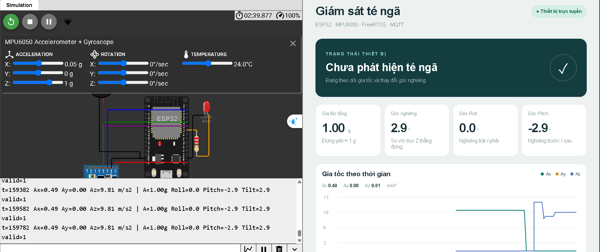

Hình 3.4. Kết quả kiểm thử chức năng Reset trạng thái cảnh báo té ngã từ giao diện Web

Nhấn nút điều khiển LED trên giao diện Web ở chế độ MANUAL

Khi chuyển hệ thống sang chế độ hoạt động thủ công (MANUAL), người dùng có thể nhấn nút điều khiển LED trên giao diện Web. Lệnh điều khiển JSON được gửi đến MQTT Broker thông qua topic utc/lovis/de5/fall/a73c91/command, sau đó ESP32 tiếp nhận vào commandQueue và bật/tắt đèn LED đỏ trên chân GPIO 18 tương ứng.

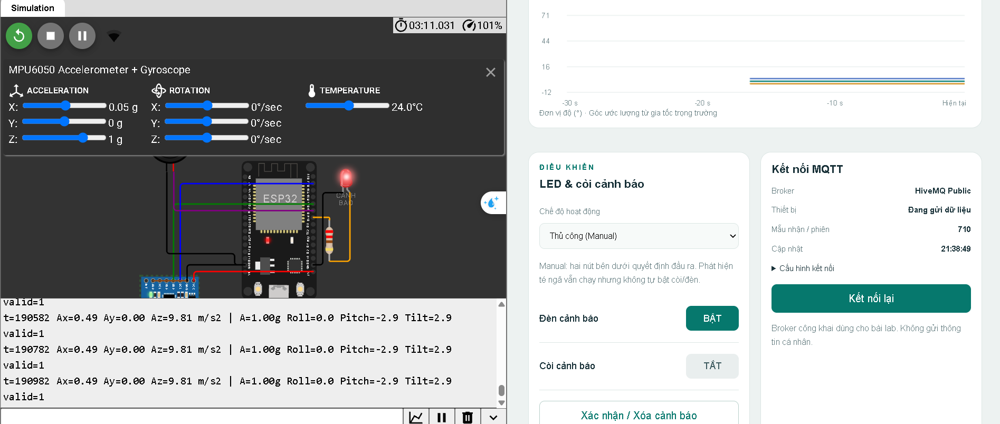

Hình 3.5. Kết quả kiểm thử điều khiển LED từ giao diện Web ở chế độ MANUAL

Nhấn nút điều khiển Buzzer trên giao diện Web ở chế độ MANUAL

Tương tự, khi hệ thống đang ở chế độ MANUAL,  người dùng nhấn nút điều khiển Buzzer trên giao diện Web. Lệnh điều khiển được gửi qua topic utc/lovis/de5/fall/a73c91/command xuống ESP32 để kích hoạt xung âm tần 2000 Hz trên chân GPIO 19, làm còi Buzzer phát tín hiệu âm thanh và đồng bộ trạng thái hiển thị về giao diện Web.

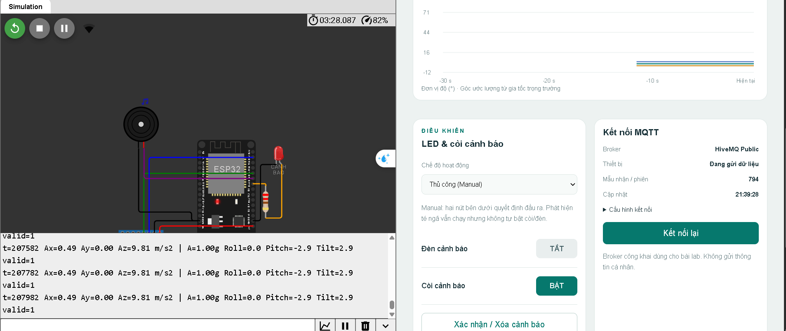

Hình 3.6. Kết quả kiểm thử điều khiển Buzzer từ giao diện Web ở chế độ MANUAL
